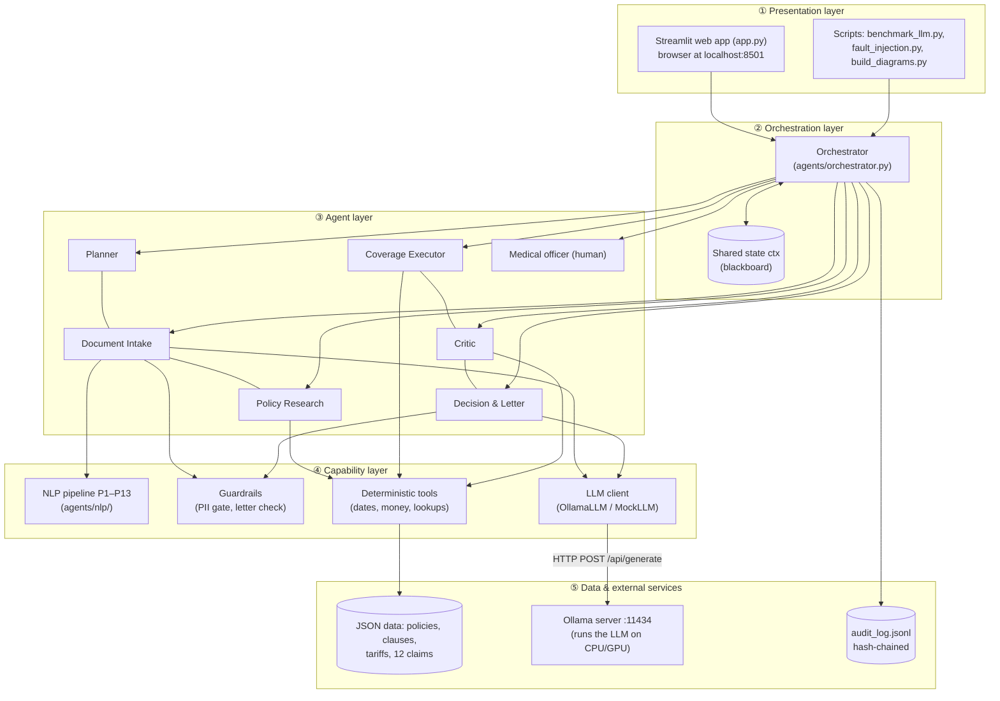
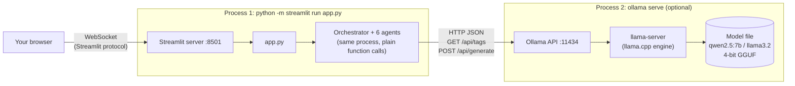
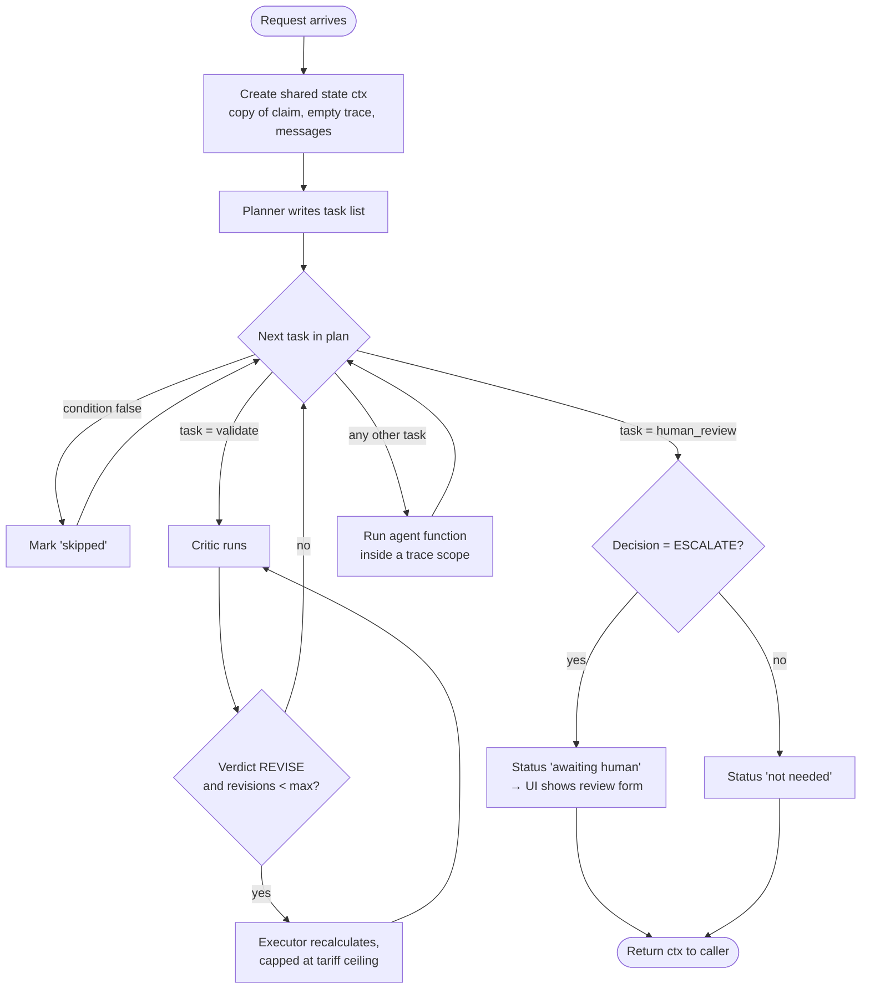
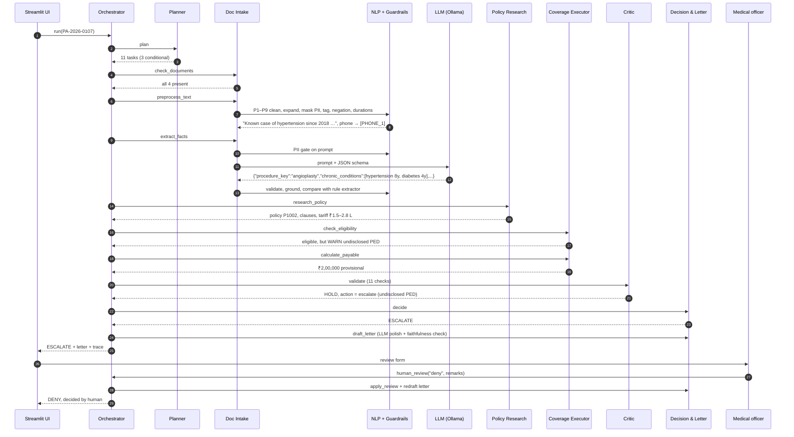
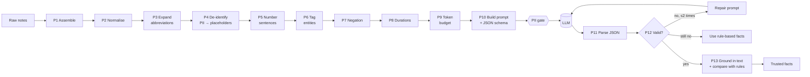
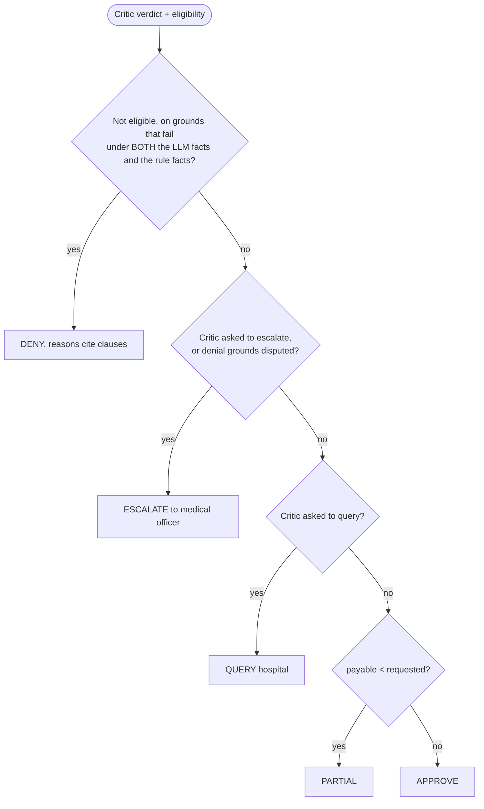

# ClaimPilot: Project Guide

*A from-scratch explanation of what this project does, how the backend runs, and how its parts talk
to each other. Read it top to bottom once, then use the section headings as a reference.*

---

## 1. The problem in one paragraph

In India, when a patient with health insurance is admitted to a hospital, the hospital does not want
to wait for the patient to pay and claim later. It sends the insurer (or its **TPA**, Third Party
Administrator) a **cashless pre-authorisation request**: *"This patient needs this treatment, it will
cost about this much, will you pay us directly?"* Someone at the insurer must read the doctor's notes,
check the policy (is it active, are there waiting periods, is the treatment excluded, are there
limits?), calculate how much is payable, and reply with a letter. This project automates that desk
with **six cooperating AI agents**, a **local open-source language model (LLM)**, and a **human
medical officer** for risky cases. All data is synthetic.

**Input:** one request (patient, policy number, diagnosis, doctor's notes, cost estimate, documents).
**Output:** a decision, an amount, reasons that cite policy clauses, a letter to the hospital, a
diagram of everything that happened, and an audit record.

The five possible decisions:

| Decision | Meaning |
|---|---|
| **APPROVE** | Pay the full estimate |
| **PARTIAL** | Pay part of it (limits, co-pay, room-rent cap…) |
| **QUERY** | Ask the hospital for missing documents |
| **DENY** | Not covered by the policy |
| **ESCALATE** | Too risky for the machine: a human medical officer decides |

---

## 2. Glossary (words used everywhere below)

| Term | Meaning |
|---|---|
| **Agent** | A Python class with one job (plan, read documents, check policy…). Each has a name, tasks and tools. |
| **Orchestrator** | The coordinator. Runs agents in order; agents never call each other directly. |
| **Blackboard / shared state (`ctx`)** | One Python dictionary that every agent reads from and writes to. |
| **Tool** | A plain, deterministic Python function an agent calls (date maths, money calculator, policy lookup). Same input → same output. |
| **LLM** | Large Language Model. Here: Llama 3.2 3B or Qwen 2.5 7B, running **locally** through Ollama. |
| **Ollama** | A program that runs open-source LLMs on your own machine and exposes them through an HTTP API on `localhost:11434`. |
| **Guardrail** | A check placed around every LLM call (privacy check before, faithfulness check after). |
| **Grounding** | Verifying that what the LLM claims is actually written in the notes. |
| **PED** | Pre-Existing Disease, e.g. diabetes the patient had before buying the policy. |
| **Sub-limit / co-pay / room-rent cap** | Policy rules that reduce the payable amount. |
| **Trace** | The recorded list of every step and every tool / LLM call, used for diagrams and audit. |

---

## 3. The big picture: architecture in layers

The system is a **single Python process** (plus an optional Ollama process). It is organised in
layers; each layer only talks to the one below it.



**Key design rules (worth saying out loud to your professor):**

1. **Agents never call each other.** Every agent receives the shared state, does its job, writes its
   result back, and returns a short summary. Only the Orchestrator decides who runs next. This is the
   *blackboard pattern*. It keeps agents independent and every hand-off visible.
2. **The LLM only reads and writes text.** It extracts facts from the doctor's notes and polishes the
   letter. **Money, dates, policy rules and the final decision are plain Python**, so they are exact
   and repeatable. An LLM never decides how much is paid.
3. **Nothing the LLM says is trusted blindly.** Its output is validated, checked against the text,
   compared with a second rule-based extractor, and re-checked by the Critic agent.
4. **Risky cases stop for a human.** The system escalates instead of guessing.
5. **Everything is recorded.** Every step and call goes into a trace and an audit log.

---

## 4. How the processes and services interact at runtime

There are up to **two running processes**:



- **Browser ↔ Streamlit:** Streamlit re-runs `app.py` top to bottom whenever you click something, and
  streams the page to the browser over a WebSocket.
- **App ↔ Agents:** ordinary Python function calls inside the same process. There is no network
  between agents; "messages" between them are logged entries in the shared state.
- **Agents ↔ LLM:** the only network call. `OllamaLLM` (in `agents/llm.py`) sends HTTP requests to the
  Ollama server:
  - `GET /api/tags` lists installed models (used to check Ollama is up).
  - `POST /api/generate` sends one prompt and receives one answer.
- **If Ollama is not running**, the app automatically switches to `MockLLM`, a clearly labelled
  *simulated* LLM that answers with rules, so the demo never breaks. Both classes have the same
  interface (`generate(prompt, system, schema, purpose)`), so agents don't know which one they use.

**What a real LLM request looks like** (sent by `OllamaLLM.generate`):

```json
POST http://localhost:11434/api/generate
{
  "model": "llama3.2",
  "system": "You are a clinical information-extraction assistant ...",
  "prompt": "### Allowed values ... ### Task\nS1: Diagnosis: ...\nS2: ...",
  "format": { "type": "object", "properties": { "procedure_key": {...}, ... } },
  "options": { "temperature": 0, "seed": 42, "num_ctx": 4096, "num_predict": 512 },
  "stream": false
}
```

- `format` carries a **JSON schema**. Ollama uses it for *grammar-constrained decoding*: the model is
  only allowed to produce tokens that keep the output valid JSON in that shape.
- `temperature 0` + fixed `seed` make answers repeatable.
- Answers are **cached** in memory (SHA-256 of model + prompt) so the same request is not sent twice.
- If an old Ollama version rejects the schema, the client retries with plain `"format": "json"`.

---

## 5. The six agents (and the human)

| # | Agent | File | What it does | Tools it calls |
|---|---|---|---|---|
| 1 | **Planner** | `planner.py` | Profiles the request (emergency? surgical? senior citizen?) and writes an **11-task plan**, some tasks with conditions | none |
| 2 | **Document Intake** | `intake.py` | Checks mandatory documents; cleans and de-identifies the notes; asks the LLM to extract facts; verifies accident papers if needed | NLP pipeline, LLM, guardrails |
| 3 | **Policy Research** | `research.py` | Fetches the policy, finds relevant policy clauses, looks up the network price (tariff) for the procedure | `policy_lookup`, `clause_search`, `tariff_lookup` |
| 4 | **Coverage Executor** | `executor.py` | Runs the eligibility rules; calculates the payable amount | date tools, money calculator |
| 5 | **Critic** | `critic.py` | Independently re-checks everyone's work (11 checks); can send work back or stop the case | `independent_recompute`, `icd10_lookup`, `assess_eligibility` |
| 6 | **Decision & Letter** | `decision.py` | Picks the final decision; drafts the hospital letter with LLM polishing | LLM, guardrails |
| 👤 | **Medical officer** | (UI panel) | A human who decides escalated cases | Streamlit form |

### The plan the Planner writes

| Task id | Agent | Runs when |
|---|---|---|
| `check_documents` | Intake | always |
| `preprocess_text` | Intake | always |
| `extract_facts` | Intake | always |
| `verify_accident_docs` | Intake | **only if accident** |
| `research_policy` | Research | always |
| `check_eligibility` | Executor | always |
| `calculate_payable` | Executor | **only if eligible** |
| `validate` | Critic | always (may loop back to `calculate_payable`) |
| `decide` | Decision | always |
| `draft_letter` | Decision | always |
| `human_review` | Medical officer | **only if escalated** |

Because tasks carry conditions, the workflow **adapts at run time** to what earlier agents discovered.

---

## 6. Inside the Orchestrator: how a request is actually executed

File: `agents/orchestrator.py`, method `Orchestrator.run(claim)`.



Each task runs through one helper, `_step()`, which does four things:

1. **Opens a trace scope** (`trace.begin()`): every tool, NLP stage, LLM call and guardrail check made
   inside this step registers itself automatically (`trace.record(...)`, using Python `contextvars`).
2. **Runs the agent function** with the shared state and times it.
3. **Saves a trace entry**: agent, task, summary, details, milliseconds, list of calls.
4. **Logs two messages** (`Orchestrator → Agent: task` and `Agent → Orchestrator: result`) so the
   UI can draw the conversation.

**The three loops in the system:**

| Loop | Trigger | What happens |
|---|---|---|
| **Critic → Executor revision** | Hospital estimate far above the network tariff | Critic returns `REVISE`; Executor recalculates with a cap; Critic checks again (max 2 rounds) |
| **Hospital query / re-submission** | Missing documents → `QUERY` | Hospital "uploads" documents (`Orchestrator.resubmit`) and the whole workflow re-runs |
| **Human in the loop** | `ESCALATE` | Workflow pauses; medical officer chooses approve / deny / query; letter is redrafted |

---

## 7. Walkthrough: one request from start to finish

Example **PA-2026-0107**: a 64-year-old woman needs an angioplasty. The notes say
*"K/c/o HTN since 2018 … T2DM x 4 yrs … Attendant contact 9000000001"*. Her policy did **not**
declare these diseases.



---

## 8. How the doctor's notes are prepared for the LLM (P1–P13)

This is the most "AI-heavy" part. Files: `agents/nlp/preprocess.py`, `prompts.py`, `parsing.py`.



| Stage | What it does | Example |
|---|---|---|
| P2 Normalise | Unicode, quotes, `5mg` → `5 mg` | |
| P3 Expand | 41 medical abbreviations | `K/c/o HTN` → `Known case of hypertension` |
| P4 De-identify | Names, phones, emails, IDs, titled names → placeholders; the original values stay on the machine | `Mrs Lata Kulkarni` → `Mrs [PATIENT]` |
| P5–P8 | Split into numbered sentences, tag conditions/procedures, detect negation, convert durations | `No h/o DM` → diabetes **negated**; `since 2018` → 8 years |
| PII gate | Blocks the LLM call if any identifier is still in the prompt, using a second independent scan | |
| P11–P12 | Extract JSON from the answer, validate against the schema, retry with a repair prompt | |
| P13 | Every condition must be written, un-negated, in the cited sentence; durations are taken from the text; result compared with a rule-based extractor | |

**Why two extractors?** The rule-based extractor (dictionary + negation rules) gives an independent
second opinion. If the LLM and the rules disagree in a way that would **change the outcome**, the
Critic escalates to a human.

---

## 9. The decision logic

### Eligibility rules (Coverage Executor)
Member on the policy · policy in force · initial 30-day waiting period (not for accidents) · specific
waiting periods (e.g. hernia 24 months) · permanent exclusions (cosmetic, dental unless accident) ·
pre-existing diseases (declared → waiting period; undisclosed → warning).

### Payable amount ("waterfall")
`requested estimate` → room-rent proportionate deduction → ICU cap → procedure sub-limit →
(reasonable & customary cap, only if the Critic asks) → co-pay % → balance sum insured →
**payable**.

### The Critic's 11 checks
Documents · ICD-10 code vs diagnosis · LLM output validity · evidence grounding · LLM-vs-rules
agreement (does a disagreement change the outcome?) · PII protection · undisclosed PED · tariff
benchmark · independent recalculation of the amount · amount sanity · authority limit (₹3 lakh).
Each failed check carries an **action**: `revise`, `query` or `escalate`. Verdict = REVISE / HOLD / PASS.

### Decision ladder (first match wins)



### The letter
Template letter (deterministic) → de-identify → PII gate → LLM polishes the opening paragraph →
strip echoed markers → re-identify → **faithfulness check**. The check requires the same ₹ amounts,
clause numbers and placeholders, every reason word for word, and no wording of the opposite
decision. If anything fails, the plain template is sent.

---

## 10. Safety, privacy and audit (cross-cutting services)

| Concern | Mechanism | Where |
|---|---|---|
| Patient privacy | De-identification (P4) + two-way PII gate before every LLM call; LLM runs locally, nothing leaves the machine | `preprocess.py`, `guardrails.py` |
| LLM hallucination | Schema validation, grounding, rule cross-check, Critic | `parsing.py`, `critic.py` |
| Wrong amounts | Two independently written calculations must agree | `executor.py`, `critic.py` |
| Wrong letter | Faithfulness check, template fallback | `guardrails.py` |
| Accountability | Full trace per run; downloadable JSON audit record; append-only log where each line stores the SHA-256 of the previous line (tamper-evident) | `trace.py`, `orchestrator.py` |
| Robustness | Fault injection: corrupt the LLM on purpose (12 fault types) and confirm no wrong decision gets out | `faults.py`, `scripts/fault_injection.py` |

---

## 11. The four architecture diagrams (`assets/`)

These PNGs are shown in the app's **🏗️ Architecture** tab. How to present each:

| File | What it shows | What to point at |
|---|---|---|
| `architecture_system.png` | Layers: UI, Orchestrator, agents, tools, LLM runtime, guardrails, data, with numbered flow | Agents never talk directly; only the Intake and Decision agents touch the LLM; every LLM call passes a guardrail |
| `architecture_sequence.png` | Every single call of one real run (PA-2026-0108, 50 messages), drawn from the trace | Red arrow = Critic sends the amount back to the Executor (revision loop) |
| `architecture_llm_pipeline.png` | Stages P1–P13, including what happens inside Ollama (tokenizer → transformer layers → constrained decoding) | PII gate before the model; validation, repair and grounding after it |
| `architecture_decision_logic.png` | Eligibility rules, payable waterfall, Critic checks, decision ladder | How a claim becomes one of five decisions |

Note: the decision-logic PNG predates the latest change to the ladder. Its HTML source is updated;
regenerate with `pip install playwright`, `playwright install chromium`, then
`python scripts/build_diagrams.py --png`.

The app also draws a **live sequence diagram for every run** (tab "Execution sequence"). It is built
from the trace by `viz/sequence.py`, so it is never out of date.

---

## 12. Code map

```
preauth_agent/
├── app.py                    Streamlit UI (presentation layer)
├── agents/
│   ├── orchestrator.py       run(), _step(), loops, human review, audit log
│   ├── planner.py            11-task plan with conditions
│   ├── intake.py             documents, preprocessing, LLM extraction
│   ├── research.py           policy, clauses, tariff
│   ├── executor.py           eligibility rules, payable waterfall
│   ├── critic.py             11 independent checks, verdict
│   ├── decision.py           decision ladder, letter, human review
│   ├── llm.py                OllamaLLM (HTTP client) + MockLLM
│   ├── guardrails.py         PII gate, de/re-identification, letter check
│   ├── tools.py              deterministic tools + data loading
│   ├── trace.py              call recorder (contextvars)
│   ├── faults.py             FaultyLLM for fault injection
│   ├── evaluation.py         scoring against hand labels
│   └── nlp/                  preprocess.py (P1–P9), prompts.py (P10), parsing.py (P11–P13)
├── viz/sequence.py           live UML sequence diagram (SVG)
├── viz/theme.py, charts.py   dashboard styling and charts (presentation only, no logic)
├── .streamlit/config.toml    light / dark colour theme
├── data/                     policies, 11 policy clauses, tariffs, 12 labelled claims
├── tests/                    87 automated tests, incl. a fake Ollama HTTP server
├── scripts/                  benchmark_llm.py, fault_injection.py, build_diagrams.py
├── results/                  measured benchmark and fault-injection tables
└── assets/                   architecture diagrams
```

---

## 13. Results to quote

| What | Result |
|---|---|
| Real LLM (Qwen 2.5 7B on a CPU-only laptop), 12 labelled cases | **12/12 decisions correct, 0 wrong decisions sent**, valid JSON on the first try 12/12, letters accepted 12/12 |
| Field accuracy (real LLM) | procedure, conditions, cosmetic, accident 100 %; `functional_need` 67 % (the errors never changed a decision) |
| Speed (real LLM, CPU only) | ~15–30 s per case for both LLM calls; agent logic itself ~25 ms |
| Fault injection (115 corrupted runs) | Before hardening: 14 wrong decisions, 17 bad letters. Now: **0 and 0** |
| Automated tests | 87 passing |

---

## 14. Questions your professor may ask

**Why multiple agents instead of one big LLM prompt?**
Each agent has one responsibility and can be tested alone. Deterministic agents (Executor, Critic)
handle money and rules exactly, while the LLM is limited to reading text. The Critic is an
independent reviewer, which a single prompt cannot be.

**How do the agents communicate?**
Through the Orchestrator and a shared state dictionary (blackboard pattern), not direct calls. Each
hand-off is logged as a message, which is what the sequence diagram draws.

**What happens if the LLM is wrong or unavailable?**
Invalid JSON → repair prompt → rule-based fallback. Invented facts → removed by grounding.
Disagreement that matters → escalated to a human. Ollama down → simulated LLM. Fault injection
shows no wrong decision gets out.

**Is patient data sent to the cloud?**
No. The LLM runs locally through Ollama, and even then identifiers are replaced by placeholders and
a PII gate checks every prompt before it is sent.

**How is it deterministic if it uses an LLM?**
Temperature 0, fixed seed, JSON schema, caching; and the LLM never computes money, dates or the
decision.

**Is the process sequential or parallel?**
Sequential, in plan order, inside one process. That is enough for one request at a time and makes
the trace easy to follow. A production version could run independent tasks in parallel and put the
agents behind a queue.

**How would this scale to production?**
Replace JSON files with a database and the insurer's policy system, add OCR for scanned documents,
run Ollama (or another model server) on a GPU machine, put the Orchestrator behind an API with a
job queue, and keep the human review step.

**Limitations?**
Synthetic data and 12 test cases; small medical dictionary; keyword (not semantic) clause search;
the rule cross-check cannot catch a mistake both extractors make.

---

## 15. Running a demo

Open Command Prompt:

```
cd "C:\Users\Rishik Sinha\Desktop\Projects\FAII_project\preauth_agent"
python -m streamlit run app.py
```

Optional real LLM (separate window, leave it open):

```
"C:\Users\Rishik Sinha\AppData\Local\Programs\Ollama\ollama.exe" serve
```

Suggested 5-minute demo:
1. **PA-0103** (knee replacement): open the **Amount** tab to show the payable waterfall.
2. **PA-0107** (angioplasty): the **LLM text pipeline** tab shows abbreviations expanded and PII
   masked; the case escalates and you decide as the medical officer.
3. **PA-0108** (gallbladder): the **Execution sequence** tab; point at the red REVISE loop.
4. **PA-0106** (dengue): QUERY, then "Upload requested documents and re-run", then APPROVE.
5. **Batch evaluation** tab: 12/12, 0 wrong decisions.
6. Sidebar → "Inject an LLM error" → `flipped_functional`, run **PA-0105**: the guardrails catch it.
