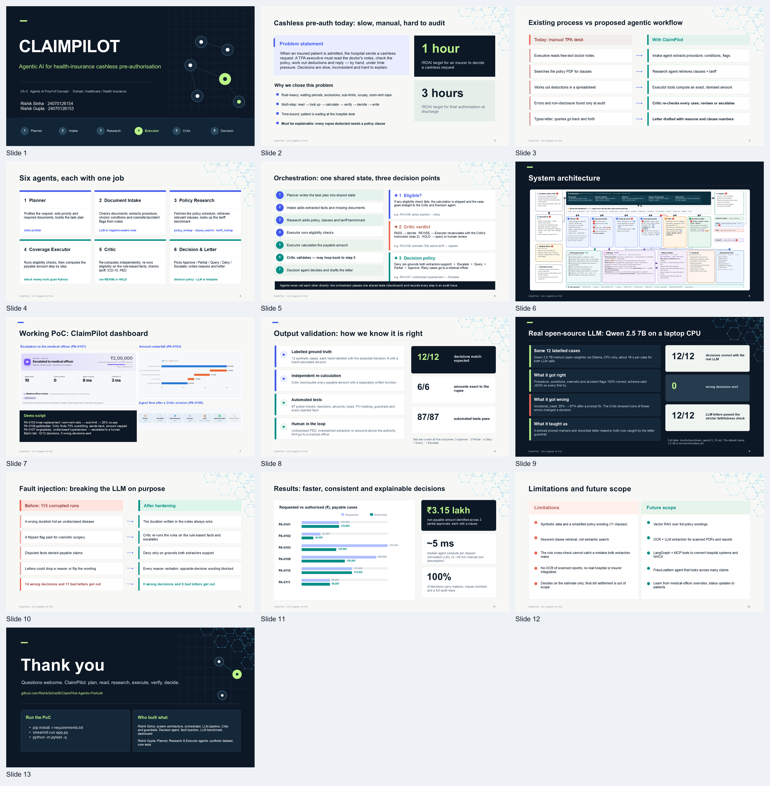

# ClaimPilot — Agentic AI for Health-Insurance Cashless Pre-Authorisation

CA-3 Agentic AI Proof of Concept · Domain: Healthcare / Healthcare intelligence (TPA operations)

Six cooperating agents take a hospital's cashless pre-authorisation request and return a validated
decision (Approve / Partial / Query / Deny / Escalate), the amount, reasons with policy clause numbers,
a letter to the hospital, an execution-sequence diagram and a full audit record. Risky cases wait for
a human medical officer. All data is synthetic.

**CA-3 submission:** [Presentation (PPT)](ClaimPilot_CA3.pptx) · [Project report (Docx)](ClaimPilot_CA3_Report.docx) · [Project guide](PROJECT_GUIDE.md)



## Open-source LLM used

| | |
|---|---|
| Model | **Meta Llama 3.2 3B Instruct** (open weights, Llama 3.2 Community License) |
| Served by | **Ollama** (`ollama pull llama3.2`), which runs it with llama.cpp on CPU or GPU, fully offline |
| File | 4-bit Q4_K_M GGUF, about 2.0 GB |
| Architecture | 28 decoder layers, 3,072 hidden size, grouped-query attention (24 query / 8 KV heads), 128,256-token BPE vocabulary, 128K context (we use 4,096) |
| Settings | temperature 0, seed 42, `num_ctx` 4096, `num_predict` 512, JSON-schema structured output |
| Used for | (1) extracting facts from de-identified doctor's notes as JSON, (2) polishing the hospital letter |
| Never used for | money, dates, policy rules or the final decision (deterministic Python tools do that) |
| Alternatives | `llama3.2:1b`, `qwen2.5:3b`, `qwen2.5:7b` (benchmarked below), `phi3.5`, `mistral` — choose in the sidebar |
| No Ollama? | A clearly labelled **simulated LLM** reads the same prompt and answers with rules, so the demo never breaks |

## Run it

```bash
python -m venv .venv
# Windows: .venv\Scripts\activate    macOS/Linux: source .venv/bin/activate
pip install -r requirements.txt

# optional but recommended: the real open-source LLM
#   install Ollama from https://ollama.com, then:
ollama pull llama3.2

streamlit run app.py          # http://localhost:8501
python -m pytest -q           # 87 tests
python scripts/benchmark_llm.py --model llama3.2   # real-model accuracy, safety outcomes, latency, tokens
python scripts/fault_injection.py --strict         # corrupt the LLM on purpose; fails if anything wrong gets out
```

`scripts/benchmark_llm.py` writes `results/benchmark_<model>.md` (and a `.json` with the raw LLM
output per case). On a CPU-only laptop a 7B model takes about 15–25 s per call; pass `--timeout 900`
if calls time out. See [Validation](#validation) for the measured numbers.

## How text is prepared for the LLM (stages P1–P13)

| Stage | What happens | Example (PA-2026-0107) |
|---|---|---|
| P1 Assemble | diagnosis + proposed treatment + doctor's notes as sections | |
| P2 Normalise | NFKC, quotes/dashes, number–unit spacing, whitespace | `5mg` → `5 mg` |
| P3 Expand | 41 medical abbreviations, case-aware boundaries | `K/c/o HTN` → `Known case of hypertension`, `T2DM x 4 yrs` → `type 2 diabetes mellitus for 4 years` |
| P4 De-identify | patient name (and its parts), hospital, policy / claim no., mobile and landline numbers, e-mail, Aadhaar / PAN, any titled name (`Dr. Mehta`, `Mr Ramesh Patil`) → placeholders (map kept locally) | `Mrs Lata Kulkarni` → `Mrs [PATIENT]`, `9000000001` → `[PHONE_1]` |
| P5 Segment | numbered sentences S1…Sn | `S4: Known case of hypertension since 2018 …` |
| P6 Tag | gazetteer of conditions, procedures, drugs, tests, flags | hypertension = CONDITION |
| P7 Negation | NegEx-style triggers with an 8-token scope | `No h/o DM/HTN/asthma` → all three negated |
| P8 Durations | `since 2018`, `for 4 years`, `x 3 mths` → years | hypertension 8 y, diabetes 4 y |
| P9 Token budget | ≈4 chars/token; trim low-value sentences above 1,200 tokens | ~160 tokens |
| P10 Prompt | system rules + allowed values + 1 worked example + numbered sentences + JSON schema | |
| PII gate | blocks the call if (a) any identifier P4 masked is still in the prompt, or (b) an independent scan that does not trust P4 finds the claim's own identifiers, a 10+ digit number, an e-mail or a titled name | pass |
| LLM | Ollama: chat template → BPE tokenizer → 28 transformer layers → grammar-constrained decoding (temperature 0) → text | |
| P11 Parse | strip fences / chatter, extract first JSON object, map synonyms | |
| P12 Validate | schema check → repair prompt (max 2) → else rule-based facts | |
| P13 Ground + compare | each condition must be stated, un-negated, in its cited sentence; a duration stated in the text replaces the model's; compare with the rule extractor | hypertension S4 grounded, 8 y |

The letter takes the same route: template → de-identify (including the medical officer's remarks) →
PII gate → LLM polish → strip echoed markers → re-identify → **faithfulness check**: same ₹ amounts,
clause numbers and placeholders, every reason word for word, and no wording of the opposite decision
(e.g. "pleased to authorise" in a denial). Otherwise the template is sent.

## Agents and orchestration

| Agent | Tasks (task id) | Tools |
|---|---|---|
| Planner | writes an 11-task plan with run-time conditions | — |
| Document Intake | `check_documents`, `preprocess_text` (P1–P9), `extract_facts` (P10–P13), `verify_accident_docs` (if accident) | NLP pipeline, LLM, guardrails |
| Policy Research | `research_policy` | `policy_lookup`, `clause_search`, `tariff_lookup` |
| Coverage Executor | `check_eligibility` (6 rules), `calculate_payable` (if eligible) | date tools, money calculator |
| Critic | `validate` — 11 checks, verdict PASS / REVISE / HOLD; re-runs the eligibility rules on the rule-based facts when the extractors disagree | `independent_recompute`, `icd10_lookup`, `assess_eligibility` |
| Decision & Letter | `decide` (ladder), `draft_letter` | LLM, guardrails |
| Medical officer (human) | `human_review` (if escalated); letter reasons follow the escalation cause | Streamlit panel |

**Decision ladder** (first match wins): **Deny**, only on failed checks that hold identically under
both the LLM facts and the rule-based facts → **Escalate** (Critic asks for it, or the denial rests on
disputed facts) → **Query** → **Partial** → **Approve**. An extractor disagreement escalates when it
involves the procedure or the accident flag, or when it changes the eligibility outcome; otherwise it
is only a warning.

The **Orchestrator** runs the Planner's task list over one shared state (blackboard). Tasks run only
when their condition (`always / accident / eligible / escalated`) holds. Two loops: the Critic can send
the case back to the Executor (`REVISE`, max 2), and a `QUERY` lets the hospital re-submit documents
and re-run. Every step, every tool / NLP / LLM / guardrail call and every message is recorded. The
**Execution sequence** tab draws that record as a UML sequence diagram.

## Architecture diagrams (`assets/`)

1. `architecture_system.png`: layers, agents, tools, LLM runtime, guardrails, data, numbered flow
2. `architecture_sequence.png`: every call of one real run (PA-2026-0108), 50 messages
3. `architecture_llm_pipeline.png`: P1–P13, including what happens inside the LLM runtime
4. `architecture_decision_logic.png`: eligibility rules, payable waterfall, Critic checks, decision ladder

Regenerate with `python scripts/build_diagrams.py --png` (needs `pip install playwright` and
`playwright install chromium`). The source of diagram 4 (`assets/diagrams/decision_logic.html`)
already shows the hardened decision ladder; its PNG needs this regeneration to match.

## Synthetic test cases (12, hand-labelled)

| ID | Case | Expected | What it shows |
|---|---|---|---|
| 0101 | Appendectomy, emergency | APPROVE ₹1,30,000 | happy path; "No h/o DM/HTN" negated |
| 0102 | Cataract | PARTIAL ₹40,000 | sub-limit |
| 0103 | Knee replacement, senior | PARTIAL ₹1,20,000 | room-rent ratio 60 % → sub-limit → 20 % co-pay; declared PED |
| 0104 | Hernia, policy 17 days old | DENY | initial + specific waiting period |
| 0105 | Rhinoplasty, aesthetic | DENY | cosmetic exclusion; "no obstruction" negated |
| 0106 | Dengue, reports missing | QUERY → APPROVE ₹47,000 after re-submission | hospital loop |
| 0107 | Angioplasty, `K/c/o HTN since 2018`, name + phone in notes | ESCALATE | abbreviations, PII masking, undisclosed PED → human |
| 0108 | Gallbladder, inflated estimate | PARTIAL ₹1,50,000 | Critic → Executor revision loop |
| 0109 | Pneumonia, policy expired | DENY | policy not in force |
| 0110 | Femur fracture, road accident | APPROVE ₹1,75,000 | accident branch: MLC / FIR check |
| 0111 | Hernia, group policy, `No h/o DM/HTN/asthma` | APPROVE ₹98,000 | negation-heavy notes; group waiver |
| 0112 | Impacted third molar | DENY | dental exclusion; "No h/o trauma or RTA" must not trigger accident |

## Validation

### 1. Simulated LLM (offline)

12/12 decisions, 60/60 extracted facts and 6/6 amounts match the labels. Read this with care: the
simulated LLM answers with the same rule extractor the Critic cross-checks against, so the facts score
measures the rule extractor, and the "extractors agree" check is true by construction (the app and the
Critic say so).

### 2. Real open-source LLM

Measured with **Qwen 2.5 7B Instruct** (`qwen2.5:7b`, Q4_K_M, open weights) through Ollama on a
CPU-only laptop (Intel Core 7 150U, 16 GB RAM). Llama 3.2 3B, the default, has not been benchmarked
yet: run `ollama pull llama3.2` and `python scripts/benchmark_llm.py`.

| Metric | First run | After the fixes in this version |
|---|---|---|
| Decisions correct | 12/12 | 12/12 |
| Wrong decisions sent | 0 | 0 |
| Schema-valid JSON on first attempt | 12/12 | 12/12 |
| procedure / conditions / cosmetic / accident correct | 100 % each | 100 % each |
| `functional_need` correct | 25 % | 67 % |
| Disagreements with the rule extractor | 9 cases | 4 cases, all judged not to change the outcome |
| LLM letters accepted by the faithfulness check | 12/12 (old check) | 12/12 (stricter check) |
| Mean LLM time per case (extraction + letter) | 17.0 s | 16.4 s |

What the real model taught us:

- Its `functional_need` errors came from an ambiguous prompt rule ("true if a functional *or medical*
  reason is written"). The rule now says it applies only to cosmetic-type treatment that restores a
  function. The remaining errors are still caught: the Critic finds the outcome is the same either way.
- It echoed the `<<<LETTER … LETTER>>>` markers back, so accepted letters would have reached the
  hospital with them. They are now stripped (and a fake-server test covers it).
- With the old letter check it could reword reasons freely (e.g. "Policy age 17 days vs 30 required"
  became a new sentence that nothing verified). The letter prompt now asks it to rewrite only the
  opening paragraph, and the check requires every reason word for word.

Raw outputs per case: `results/benchmark_qwen2.5_7b.json` (not committed; see `.gitignore`) and the
summary table `results/benchmark_qwen2.5_7b.md`.

### 3. Fault injection: does a wrong LLM answer become a wrong decision?

`scripts/fault_injection.py` wraps the LLM in `FaultyLLM` and corrupts its answers on purpose
(12 fault types: broken JSON, invented or negated conditions, wrong durations, dropped conditions, a
swapped procedure, flipped accident / cosmetic / functional flags, and letters with a changed amount, a
dropped reason or the opposite decision). Each fault runs on all 12 cases; 115 runs change the
LLM's answer.

| | Wrong decisions sent | Corrupted letters sent |
|---|---|---|
| Before this hardening | 14 | 17 |
| Now | **0** | **0** |

Escalating a case or querying the hospital counts as *held for review*: safe, but extra work.
The full table is in `results/fault_injection.md`. The 14 earlier failures came from four gaps, now closed:

- A wrong duration from the LLM ("6 months" for "since 2018") hid an undisclosed pre-existing disease.
  The duration in the text now always wins.
- A flipped `functional_need` flag lifted the cosmetic exclusion, but only raised a "minor
  disagreement". The Critic now re-runs the eligibility rules on the rule-based facts and escalates
  whenever the outcome differs.
- A flipped `cosmetic_intent` flag or a swapped procedure denied approvable claims: the Critic had
  flagged the disagreement, but "Deny" came first on the decision ladder. Now a denial needs grounds
  that fail identically under both extractors' facts.
- Letters could drop a reason or flip approval wording unnoticed. The faithfulness check now covers both.

### 4. Tests (87)

- `tests/test_pipeline.py`: decisions, amounts, facts, revision loop, conditional tasks, query re-submission, human review (reasons and amount follow the escalation cause), audit record
- `tests/test_text_pipeline.py`: normalisation, abbreviations, PII, negation, durations, JSON parsing, schema validation
- `tests/test_safety.py`: every fault on every case (no wrong decision, every corrupted letter blocked), duration correction, disputed denials, the independent PII scan and its false-positive rate on the 12 cases, masking of the officer's remarks, letter checks, hash-chained audit log
- `tests/test_ollama_integration.py`: the real Ollama client against a fake Ollama server:
  - JSON schema and temperature 0 are sent, and no PII reaches the prompt
  - repair-prompt retry and rule fallback both work
  - a hallucinated condition is rejected
  - an unfaithful letter is replaced by the template, and echoed `<<<LETTER` markers are stripped
  - old Ollama versions fall back to plain JSON mode
  - the app falls back to the simulated LLM when the server is down

## 5-minute demo script

1. PA-0103 (knee): Amount tab.
2. PA-0107 (angioplasty):
   - LLM text pipeline tab: abbreviations, PII masking, highlighted entities, the JSON
   - escalation → medical officer decides
3. PA-0108 (gallbladder): Execution sequence tab; point at the red REVISE.
4. PA-0106 (dengue): query → "Upload requested documents and re-run" → Approve.
5. Batch evaluation tab: 12/12, 0 wrong decisions sent, confusion matrix.
6. Sidebar → "Inject an LLM error" → `flipped_functional`, then PA-0105 (rhinoplasty): the corrupted
   facts alone would pay for cosmetic surgery; the Critic sees that the rule-based facts give a
   different outcome and escalates instead.

## Folder structure

```
app.py                         Streamlit UI
agents/
  orchestrator.py              plan executor, conditions, Critic loop, human-in-the-loop, audit
  planner.py intake.py research.py executor.py critic.py decision.py
  nlp/preprocess.py            P1–P9
  nlp/prompts.py               P10 prompt + JSON schema
  nlp/parsing.py               P11–P13 parse, validate, ground, compare
  llm.py                       OllamaLLM (Llama 3.2) + simulated LLM
  guardrails.py                PII gate, re-identification, letter faithfulness
  faults.py                    FaultyLLM: corrupts any backend's answers on purpose
  evaluation.py                scoring against labels: correct / held for review / wrong
  tools.py trace.py            deterministic tools, call recorder
viz/sequence.py                sequence diagram from the audit trace
viz/theme.py                   dashboard stylesheet + HTML building blocks (light and dark mode)
viz/charts.py                  Altair charts: payable waterfall, confusion heatmap, authorised vs requested, tariffs
.streamlit/config.toml         colour theme, font and validated chart palette
data/                          synthetic policies, clauses, tariffs, 12 labelled claims
tests/                         87 tests incl. fake Ollama server and fault injection
scripts/                       benchmark_llm.py, fault_injection.py, build_diagrams.py
results/                       measured benchmark and fault-injection tables
ClaimPilot_CA3.pptx            CA-3 presentation
ClaimPilot_CA3_Report.docx     CA-3 project report
assets/                        architecture diagrams (PNG) and their sources
audit/                         audit_log.jsonl, hash-chained (created at run time)
```

## Limitations

- Synthetic data and a simplified policy wording (11 clauses).
- The abbreviation dictionary and gazetteer are small and English-only.
- A 3B model can misread unusual notes. Grounding, the rule cross-check and a human reviewer limit the damage.
- The rule cross-check is only as good as the rule extractor: if both extractors make the same mistake,
  nothing flags it. Fault injection tests one wrong extractor at a time.
- The PII scan uses patterns; a name written without a title and not on the claim can still slip through.
- The audit hash chain detects edits to earlier entries but not deletion of the newest ones (no external anchor).
- 12 labelled cases are enough to show behaviour, not to estimate real-world accuracy.
- Keyword clause retrieval, not semantic search.
- No OCR and no real hospital or insurer integration.
